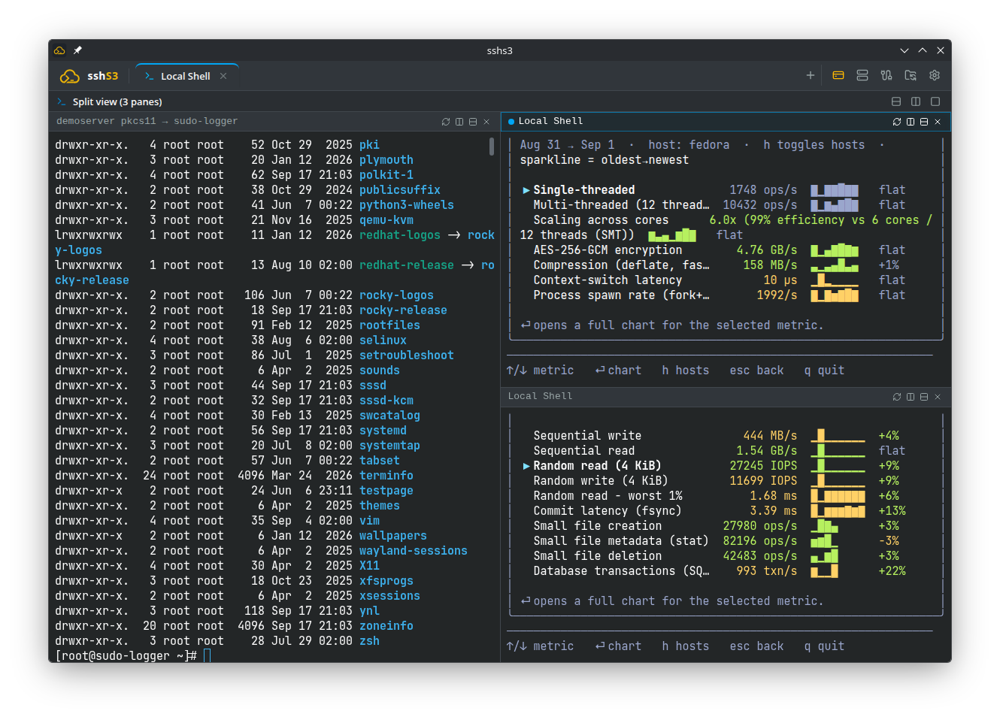
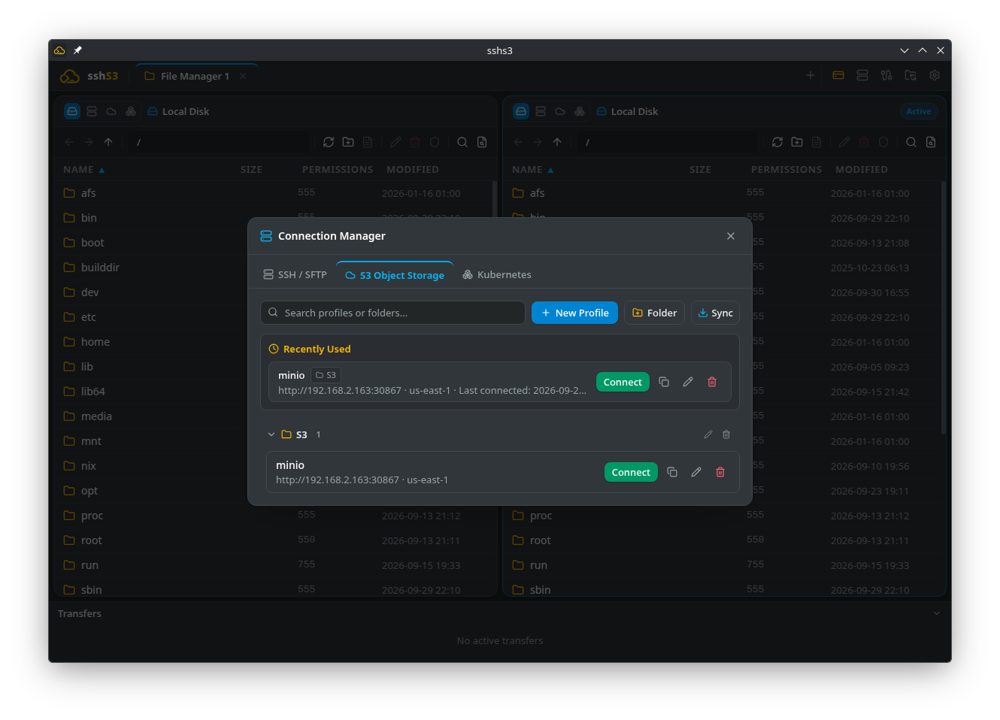
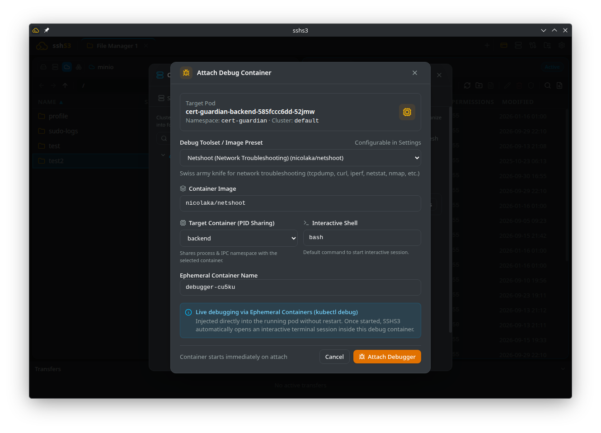

# sshs3

> **A modern, security-focused, cross-platform SSH, SFTP, S3, and Kubernetes client** for Linux and Windows, featuring hardware security key & smartcard support (FIDO2 / YubiKey / PKCS#11 / SITHS / Net iD), split terminal views, a dual-pane file manager with live Markdown preview, directory sync, and container exec & log tools.

> [!WARNING]
> **Early Development Notice**: sshs3 is under active early-stage development. Expect occasional bugs, incomplete edge-case handling, and breaking changes or frequent UI improvements between releases. Feedback and bug reports are warmly welcome — please file any issues or suggestions on [GitHub Issues](https://github.com/alun-hub/sshs3/issues)!

  
   <em>Konsole-style recursive split panes with independent SSH and local sessions</em>

  
   <em>Dual-pane file manager for local disk, SFTP, S3 buckets and Kubernetes pods</em>

  
   <em>Live ephemeral pod debugging (<code>kubectl debug</code>) from the Connection Manager</em>

---

## Overview

**sshs3** is an Electron desktop app for sysadmins, DevOps and developers who work across many servers and clusters. Your system's own `ssh` binary drives the terminal and carries SFTP (so `~/.ssh/config`, agents, aliases and jump hosts just work), the AWS SDK talks to any S3-compatible endpoint, and a built-in Kubernetes client handles clusters. See the [Product Comparison Guide](docs/COMPARISON.md) for how it compares with PuTTY, MobaXterm, WinSCP, S3 Browser, Termius and other modern SSH clients (sshpilot, SSH-Studio, RustConn).

## Download

| Platform | Format | Download |
| :--- | :--- | :--- |
| **Linux** | Standalone AppImage | [GitHub Releases](https://github.com/alun-hub/sshs3/releases/latest) (`.AppImage`) |
| **Linux (Debian / Ubuntu)** | DEB package | [GitHub Releases](https://github.com/alun-hub/sshs3/releases/latest) (`.deb`) |
| **Linux (Fedora / RHEL)** | RPM package | [GitHub Releases](https://github.com/alun-hub/sshs3/releases/latest) (`.rpm`) |
| **Linux (Fedora 44)** | COPR repository | `sudo dnf copr enable alun-hub/sshs3 && sudo dnf install sshs3` ([COPR project](https://copr.fedorainfracloud.org/coprs/alun-hub/sshs3/)) |
| **Windows** | Setup Installer (with bundled VcXsrv) | [GitHub Releases](https://github.com/alun-hub/sshs3/releases/latest) (`sshs3-Setup-*.exe`) |
| **Windows** | Portable standalone | [GitHub Releases](https://github.com/alun-hub/sshs3/releases/latest) (`sshs3-*-portable.exe`) |
| **Windows** | Portable ZIP (unpack & run) | [GitHub Releases](https://github.com/alun-hub/sshs3/releases/latest) (`sshs3-*.zip`) |

The app checks GitHub Releases for new versions (switch off under *Settings → App Behavior*, or set `SSHS3_DISABLE_UPDATES=1` for air-gapped machines) and never installs anything without your click. Windows builds are not code-signed yet, so on Windows download new versions manually. The COPR package repackages the same release: every release is built there shortly after it is published, and `dnf upgrade` installs it. If you use it, switch the in-app update check off. Release assets carry `SHA256SUMS` and a build-provenance attestation. Installation steps, requirements (OpenSSH client, keyring, smartcard drivers) and update details: [Installation & Updates](https://docs.sshs3.com/docs/getting-started/).

## What it does

- **Terminal** — real OpenSSH in tabs and recursive split panes, local shells, search, snippets, clipboard history, session restore, clickable links and paths, optional live performance bar. → [Terminal](https://docs.sshs3.com/docs/terminal/), [Performance bar](https://docs.sshs3.com/docs/performance-bar/)
- **File manager** — two panes over local disk, SFTP, S3 and Kubernetes pods; transfer queue, editor with Markdown preview, folder sync and diff, content search, `tail -f`, Git status. → [File manager](https://docs.sshs3.com/docs/file-manager/), [S3 storage](https://docs.sshs3.com/docs/s3-storage/), [Git & developer tools](https://docs.sshs3.com/docs/git-developer/)
- **Kubernetes & OpenShift** — cluster discovery from `~/.kube/config`, exec terminals, logs, pod file explorer, ephemeral debug containers, port forwarding. → [Kubernetes](https://docs.sshs3.com/docs/kubernetes/)
- **Hardware keys & smartcards** — FIDO2 / YubiKey, PKCS#11 (SITHS, Net iD, OpenSC, p11-kit), in-app PIN dialog, three PIN caching modes. → [Security & smartcards](https://docs.sshs3.com/docs/security-smartcards/), [Windows differences](https://docs.sshs3.com/docs/windows/)
- **Networking** — ProxyJump bastions, saved `-L` / `-R` / `-D` tunnels, outgoing proxies, X11 forwarding with a bundled X server on Windows. → [Networking & tunnels](https://docs.sshs3.com/docs/networking-tunnels/)
- **Profiles & sync** — folders, encrypted secrets at rest, opt-in zero-knowledge sync to your own S3 or SFTP target, dotfiles pool, Team Vault, `~/.ssh/config` kept in sync. → [Connections](https://docs.sshs3.com/docs/connections/), [Sync](https://docs.sshs3.com/docs/sync-environment/), [Team Vault](https://docs.sshs3.com/docs/team-vault/)
- **Keyboard-first** — rebindable shortcuts and mouse-free navigation with `Ctrl+Shift+Arrows`, `Enter` and `Escape`. → [Settings & shortcuts](https://docs.sshs3.com/docs/settings-shortcuts/)

## Documentation

Full user documentation lives at **[docs.sshs3.com](https://docs.sshs3.com)** (source: [`docs/user-guide/`](docs/user-guide/)). Also in this repository:

- [Product Comparison](docs/COMPARISON.md)
- [Architecture notes](docs/user-guide/architecture-internals.md) · [Third-party software](THIRD_PARTY.md)
- [Security Policy](SECURITY.md) — how to report vulnerabilities

## Privacy

sshs3 sends no telemetry, analytics or crash reports. Its only background request is the update check against GitHub Releases, which you can switch off. Private keys on hardware tokens never leave the device, and saved secrets are encrypted at rest with the OS keyring. Details, including exactly how PINs are handled, are in [Security & smartcards](https://docs.sshs3.com/docs/security-smartcards/).

## Contributing

Contributions are welcome! See the [Contributing Guide](CONTRIBUTING.md) for development setup, packaging and release, the [Code of Conduct](CODE_OF_CONDUCT.md), and the [Changelog](CHANGELOG.md) for release history.

## License

This project is licensed under the [MIT License](LICENSE).
