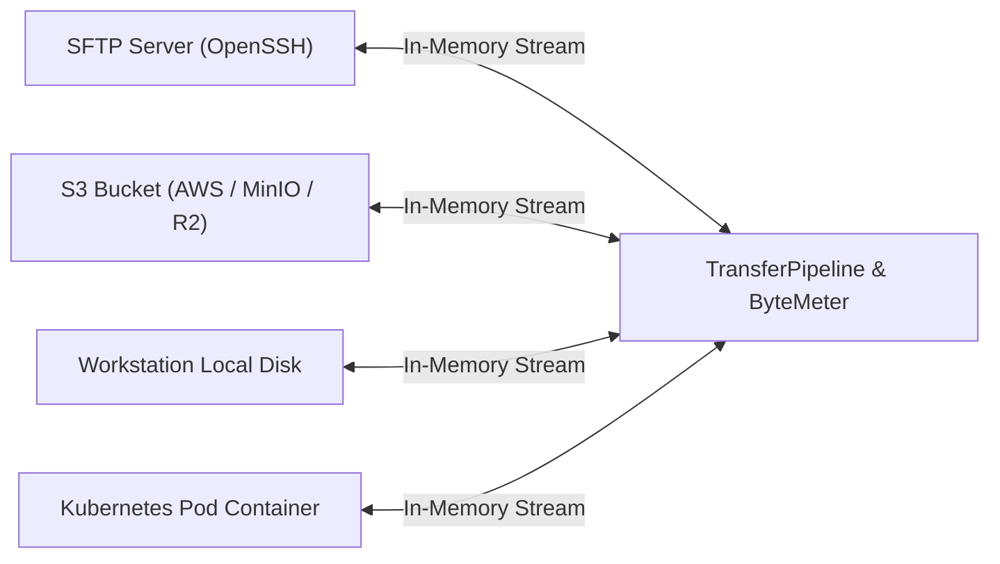

## Dual-Pane File Manager & SFTP Engine

The File Manager in **sshs3** provides a high-performance, keyboard-driven dual-pane explorer modeled after Midnight Commander and WinSCP, modernized for hybrid cloud infrastructure. It enables transparent file operations across local disks, remote OpenSSH SFTP servers, Amazon S3 object storage, and running Kubernetes containers.


---

## 1. Native OpenSSH SFTP v3 Engine

Unlike tools relying on JavaScript SSH emulators, sshs3 executes your operating system's real `ssh` binary in SFTP subsystem mode (`ssh -s sftp`). All hardware security tokens (YubiKey PIV, FIDO2), smartcards, `~/.ssh/config` directives, and proxy bastions function out of the box with zero emulation layers.

### Navigation & Spatial Keyboard Ergonomics

The dual-pane explorer is engineered to be 100% operable without a mouse:

| Key / Shortcut | Action | Description |
| :--- | :--- | :--- |
| <kbd>Ctrl</kbd>+<kbd>Shift</kbd>+<kbd>Left</kbd> / <kbd>Right</kbd> | Switch Active Pane | Toggles keyboard focus between the left and right file panes. |
| <kbd>Ctrl</kbd>+<kbd>Shift</kbd>+<kbd>Up</kbd> | Escape to Tab Bar | Focuses the Tab Bar to switch active workspace tabs with <kbd>Left</kbd>/<kbd>Right</kbd>. |
| <kbd>Enter</kbd> | Open / Edit | Enters the highlighted directory, or opens file in built-in editor. |
| <kbd>Backspace</kbd> / <kbd>Alt</kbd>+<kbd>Up</kbd> | Ascend Directory | Navigates one directory level up the folder hierarchy. |
| <kbd>Alt</kbd>+<kbd>Left</kbd> / <kbd>Right</kbd> | History Back / Forward | Navigates backward and forward through visited directories. |
| <kbd>Ctrl</kbd>+<kbd>L</kbd> / <kbd>Alt</kbd>+<kbd>D</kbd> | Edit Path | Edits the breadcrumb path directly as text; press <kbd>Enter</kbd> to jump. |
| <kbd>Ctrl</kbd>+<kbd>C</kbd> / <kbd>X</kbd> / <kbd>V</kbd> | Copy / Cut / Paste | Clipboard file operations across folders, servers, and protocols. |
| <kbd>Ctrl</kbd>+<kbd>F</kbd> | Filter Items | Real-time wildcard filter (e.g. `*.log`, `data-?-final.csv`). |
| <kbd>Ctrl</kbd>+<kbd>Shift</kbd>+<kbd>K</kbd> | Search in Files | Recursive text search (with regex support) across SFTP, S3, or local disk. |
| <kbd>Ctrl</kbd>+<kbd>H</kbd> | Toggle Hidden Files | Shows or hides dotfiles and hidden directories. |
| <kbd>F2</kbd> | Rename | Renames the selected file or folder in place. |
| <kbd>F5</kbd> | Refresh | Re-reads directory listings from the underlying storage provider. |
| <kbd>Delete</kbd> | Delete | Prompts for confirmation and deletes selected items. |

> [!TIP]
> **Type to Jump:** Typing letters anywhere in the file list instantly jumps selection to the first file or folder matching those characters.

### Disk Space, Search & Archives
- **Disk space indicator (local panes):** Click it to list every drive (Windows: `C:`, `D:`, ...) or mounted filesystem (Linux/macOS) with its fill level, and pick one to jump to its root. Offline network drives are skipped rather than freezing the list. **Up one level** from a drive root stays on that drive.
- **Disk space indicator (SFTP panes):** Shows the free space of the filesystem holding the current folder. It needs a server with the `statvfs@openssh.com` extension (OpenSSH servers have it); otherwise the indicator is hidden. For a list of all remote mounts, see the [Performance Bar](/docs/workspace/telemetry/).
- **Search in Files options:** Choose **Literal** or **Regex**, tick **Case sensitive** if needed, and narrow the search with **Include:** and **Exclude:** globs (for example `*.log, *.csv` and `*.min.js`).
- **Compress / Extract** (local disk and SFTP panes): Right-click a selection and choose **Compress to .tar.gz** or **Compress to .zip**. The archive is created next to the selection and never replaces an existing one (`archive (1).zip`). Right-click an archive (`.zip`, `.tar`, `.tar.gz`, `.tgz`, `.tar.bz2`, `.tar.xz`) and choose **Extract to Folder** to unpack it into a new folder named after the archive. On SFTP the work runs on the server, so `tar` (and `zip`/`unzip` for zip files) must be installed there; on a local Linux machine zip files also need `zip`/`unzip`.

### Technical Architecture: SFTP Subsystem & Packet Guard

`SFTPStorageProvider` (`src/main/storage/SFTPStorageProvider.ts`) spawns the system OpenSSH binary:
```bash
ssh <SmartcardFlags> -o BatchMode=no -s -- [user@]host sftp
```
- **Packet Protection:** `SftpPacketProtocol` processes binary SFTP v3 packets (`SSH_FXP_INIT`, `SSH_FXP_OPEN`, `SSH_FXP_READ`, etc.) and enforces a strict 16 MB maximum packet ceiling, shielding the client against malicious or misconfigured remote servers.
- **Backpressure Streaming:** `SftpStreams` uses Node.js `ReadableStream` and `WritableStream` with adaptive backpressure, preventing memory exhaustion when reading from high-bandwidth LAN servers.
- **Zero-Touch Askpass:** Smartcard PIN requests and FIDO2 touch prompts route seamlessly through the internal `AskpassServer`.

### Good to Know & Limitations: SFTP Subsystem & Directory Listings
- **POSIX ACLs:** SFTP v3 does not natively support advanced POSIX Access Control Lists (ACLs) or extended attributes (`xattr`) within the protocol frame; standard POSIX mode bits (`0755`, `0644`) are preserved.
- **Large Directories:** Exceptionally large directory listings (>100,000 files) may take a few seconds to enumerate over high-latency WAN links.

### Reopening Tabs After a Restart

File manager tabs come back when you restart sshs3. A tab that was opened from a saved connection reconnects by itself with that connection's saved password, key passphrase or S3 secret key, so you are not asked again. The saved session itself never contains those secrets.

- If the profile has no saved password, the tab asks for it (**Password Required for SFTP**).
- If the profile's host, port or user (SFTP), or its endpoint, region or access key (S3), was changed after the tab was saved, the tab asks again instead of sending the saved secret to the new address.
- A tab opened from a quick `user@host` has no profile behind it and always asks.

---

## 2. In-Memory Streaming Across Storage Backends

sshs3 implements a unified `IStorageProvider` interface across all storage engines, enabling direct file transfers without writing intermediate staging files to your workstation's disk:



### Transfer Queue & Conflict Resolution

- **Zero-Disk Staging:** When copying from SFTP directly to an Amazon S3 bucket (or between two remote servers), bytes stream directly through workstation memory via Node.js stream pipes.
- **Interactive Collision Handling:** When a destination file already exists, choose **Overwrite**, **Skip**, or **Rename** with an optional *Apply to all remaining conflicts* checkbox.
- **Default Action:** Configure your preferred collision policy under *Settings → Files & Storage*.

### Good to Know & Limitations: In-Memory Stream Transfers
- **Workstation Bandwidth:** When copying between two remote servers (or from SFTP directly to S3), data streams through your local workstation's network interface; transfer speed is bound by your local upload and download bandwidth.
- **Laptop Sleep / Suspend:** Suspending your workstation pauses and interrupts active network streams; keep the workstation awake during massive multi-gigabyte cloud transfers.

---

## 3. Directory Diff & Synchronization Engine

Compare two directory trees (local vs. remote, or remote vs. remote) and synchronize changes with a visual diff preview before touching the filesystem:

1. Right-click any folder and select **Sync to...**, then select your target directory.
2. Review the computed diff preview:
   - **New on source:** Will be copied to target.
   - **Modified:** Will overwrite target (newer target files are flagged with a warning).
   - **Only in target:** Preserved by default (*safe sync*).
3. **Mirror Mode:** Enable *Mirror (delete extraneous files in target)* to delete target files that no longer exist on the source.
4. **Saved Sync Profiles:** Enter a **Profile name** before running to save the configuration as a reusable profile. Saved profiles are listed under **Saved Sync Profiles**, where **Compute diff and run sync** repeats them.

### Technical Architecture: How Directory Diff Compares Files Across Drifted Clocks

Files are compared using file size and last modification timestamp. A configurable 2-second timestamp tolerance accommodates clock drift between servers and timezone differences across FAT32, NTFS, ext4, and S3 object metadata.

### Good to Know & Limitations: Directory Synchronization & Mirroring
- **One-Way Sync:** Synchronization is strictly one-way from the selected source to the target directory.
- **New Target Folders:** The target folder does not have to exist: the first sync creates it, over SFTP as well.
- **Symlinks & Unreadable Folders:** Symbolic links pointing to directories are listed but not recursively traversed. Folders that cannot be read (e.g. permission denied) are reported as skipped; nothing below a skipped folder is copied or, in Mirror mode, deleted, because its contents cannot be verified. If the root folder of the source or target cannot be listed for any reason other than not existing yet, the comparison stops with an error instead of treating it as empty.

---

## 4. Built-in CodeMirror 6 Editor & Multi-Format Previews

### Built-in Editor
Inspect, edit, and preview remote files or monitor live server logs without opening an external editor:


### Editor & Preview Capabilities

| Format / Tool | Capabilities |
| :--- | :--- |
| **CodeMirror 6 Editor** | Syntax highlighting for 15+ languages (JS, TS, Python, Bash, Nginx, YAML, JSON, SQL, Rust, Go). Monospaced font with line numbers, active line highlight, bracket matching, cursor coordinates (`Ln X, Col Y`), word-wrap toggle, and <kbd>Ctrl</kbd>+<kbd>F</kbd> search. For JSON files, **Format JSON** beautifies and re-indents minified payloads. |
| **Atomic Save (<kbd>Ctrl</kbd>+<kbd>S</kbd>)** | Saves updates back to remote SFTP, S3, or Kubernetes with timestamp confirmation (`yyyy-mm-dd HH:mm`). CRLF line endings are preserved. |
| **Markdown Preview** | Toggle between raw source and rendered GitHub Flavored Markdown with tables and task lists. You can select and copy any text. Links to web pages (`http` or `https`) open in your browser; hover over one to see where it really goes. Other links, such as links to another file or to a heading, are shown as plain text. Code blocks in common languages are colored and have a copy button (hover over the block, or tab to it). While you search, code blocks show without colors so that a phrase is found even where the colors would split it. |
| **HTML Sandbox** | Static preview in a hardened, sandboxed iframe (`sandbox=""` with external scripts and navigation blocked). |
| **CSV / TSV Data Grid** | Parses tabular data into an interactive, sortable grid with column headers and text filter. |
| **Media & Image Viewer** | Interactive zoom, pan dragging, and 90° rotation for `.png`, `.jpg`, `.webp`, `.gif`, `.svg` with dimensions and file size display. |
| **PDF Documents** | Native PDF document preview powered by Chromium's embedded PDF engine. |
| **Certificate Viewer** | Right-click a `.crt`, `.cer`, `.cert`, `.pem` or `.der` file and select **View Certificate...** for subject, issuer, validity, SANs, key, key usage, revocation URLs, fingerprints and the bundle's chain in plain language, with copy buttons and a host name check. It is decoded inside sshs3, so `openssl` is not needed on the server. Details: [Certificate Preview](/docs/workspace/terminal/#certificate-preview). |
| **Live Log Tail (`tail -f`)** | Right-click any server log (e.g. `access.log`) and select **Tail -f**. Streams growing logs in real time with auto-scroll and pause/resume without loading giant files into memory. |

### External Editor Integration
Right-click any file and select **Open in External Editor** to edit in your local desktop IDE (VS Code, Neovim, Sublime):
- The file opens in your local editor.
- When you save locally (<kbd>Ctrl</kbd>+<kbd>S</kbd>), sshs3 detects the filesystem event and streams the updated buffer back to the remote server automatically in the background!
- **Security Guard:** For workstation security, executable binaries and scripts (`.exe`, `.bat`, `.ps1`, `.sh`, `.vbs`, `.jar`) are blocked from external launching to prevent accidental execution of untrusted remote payloads.

### Good to Know & Limitations: Editor File Size Caps & Safety Locks
- **5 MB Text Editor Safety Threshold:** Text files load up to 5 MB into the built-in editor. Files exceeding 5 MB (only the first 5 MB are read), binary files, and non-UTF-8 encodings open strictly **read-only**, and save operations are disabled to prevent corrupting remote files with partial or re-encoded data. Use **Open in External Editor** to modify larger files.
- **100 MB Media Preview Ceiling:** Image and PDF previews stream up to 100 MB directly from remote SFTP or S3 backends.
- **External Editor Inode Watches:** Local editors must save files in place without breaking filesystem inode watches (e.g. `:set backupcopy=yes` in Vim).

---

## 5. Visual Git Integration

When browsing any local or remote directory containing a `.git` repository, sshs3 automatically activates the Git indicator toolbar:

- **Branch & Delta:** Displays the active branch name, uncommitted changes, and commit delta ahead (↑) or behind (↓) `origin`.
- **One-Click Pull:** Click the pull icon to synchronize the remote repository directly over the active SFTP session.
- **Repository Link:** Click the provider badge (**Open in GitHub/GitLab**) to open the repository homepage in your default browser. It appears when `remote.origin.url` is configured.
- **Remote Clone:** Right-click an empty area and select **Git Clone to here...** with optional shallow clone (`--depth 1`).

### Good to Know & Limitations: Remote Git Integration
- **Remote Git CLI Required:** Displaying Git status indicators and pulling remote repositories over SFTP requires `git` to be installed and accessible on the remote server's system `$PATH`.

---

## 6. Troubleshooting & Diagnostics

| Symptom / Error | Probable Root Cause | Corrective Action |
| :--- | :--- | :--- |
| `Permission denied` on file upload | Remote directory lacks write permissions | Check folder mode via `ls -ld <folder>`. Use `chmod 755` or connect as an authorized user. |
| `SFTP subsystem not found` | Remote `sshd_config` lacks subsystem definition | Verify `Subsystem sftp /usr/lib/openssh/sftp-server` exists in `/etc/ssh/sshd_config`. |
| External editor edits do not upload | Editor saves via atomic temporary files | Configure editor to write in-place (e.g. in Vim: `:set backupcopy=yes`). |
| "Forbidden" cursor while dragging (Linux) | Upstream Chromium / Wayland cursor quirk | Cosmetic issue: the drop operation completes normally when you release the mouse button. |
| **Password Required for SFTP** appears after a restart although a password is saved | The tab was saved for another host, port or user than the profile has now | Reconnect from **Saved Connections**; the tab then uses the current profile. |
