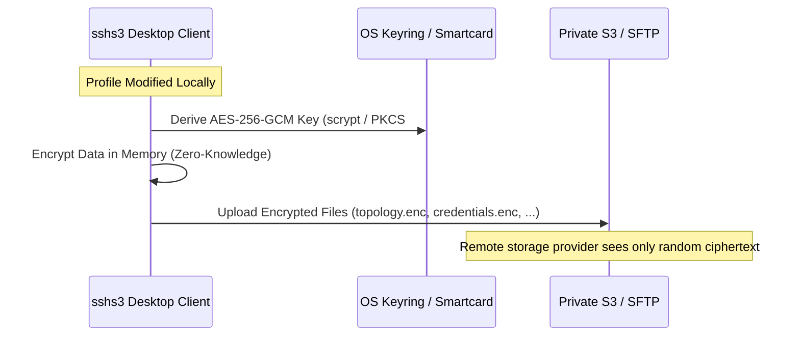

## Environment & Profile Synchronization

**sshs3** provides synchronization tools designed to keep your terminal shell settings and connection profiles synchronized across multiple workstations without compromising privacy or relying on third-party cloud accounts.


---

## 1. Dotfiles Pool Sync (Opt-In)

Reconfiguring `.bashrc`, custom aliases, `.vimrc`, or `.tmux.conf` on hundreds of remote servers is tedious. sshs3 offers an opt-in **Dotfiles Pool Sync**:

1. Open **Settings → Files & Storage**, tick **Enable dotfiles pool sync**, and click **Manage Dotfile Pools**.
2. Click **Add Files...** or drag files in (e.g. `~/.bash_aliases`, `~/.config/nvim/init.vim`).
3. You can also right-click any file in the dual-pane file manager and choose **Add to Dotfiles Pool...**.
4. Each pooled file shows a status indicator for whether the local source file changed on disk since it was pooled; click **Refresh** to re-read changed source files.
5. In any SSH profile under *Environment*, select the **Dotfiles Pool** to attach and choose a synchronization policy (e.g. silent sync upon login or interactive prompt).

> [!WARNING]
> Pooled files are stored unencrypted on your local workstation. Avoid pooling files that contain unencrypted passwords, private keys, or cloud API tokens.

### Technical Architecture: Staged Session Environments

`DotfilePoolStore` (`src/main/dotfiles/DotfilePoolStore.ts`) manages pool definitions. Upon establishing an SSH connection, a fast SFTP check compares file modification timestamps. Staged files are placed into an isolated temporary session directory on the remote server and sourced automatically without modifying permanent system configurations.

---

## 2. Remote Profile Synchronization ("Own Your Data")

For operators working across multiple workstations, sshs3 provides end-to-end encrypted profile synchronization with **zero proprietary cloud infrastructure**. You own and control your storage backend:
- A private **Amazon S3 bucket** (or MinIO, Cloudflare R2, Ceph).
- A private remote **SFTP server**.



### Zero-Knowledge Cryptographic Model

| Property | Implementation | Security Guarantee |
| :--- | :--- | :--- |
| **Payload Encryption** | AES-256-GCM (`authTagLength: 16`) | Full confidentiality and cryptographic tamper detection. |
| **Key Derivation** | `scrypt` (N=32768, r=8, p=1) | Highly resistant to offline GPU brute-force attacks. |
| **Two-Tier Password** | Optional separate passwords | Topology (hostnames/folders) vs Credentials (passwords/keys). |
| **Smartcard Unlock** | PIV / PKCS#11 deterministic signing | Choose the library under **Smartcard / Hardware token** and click **Link smartcard**; later use **Unlock with Smartcard** with only your PIN (RSA/Ed25519). |
| **Deletions** | Cryptographic tombstones | Prevents purged profiles from resurrecting after multi-device sync. |

> [!IMPORTANT]
> **Smartcard key derivation needs RSA or Ed25519.** These algorithms sign deterministically, so the card produces the same wrapping key on every unlock. ECDSA cards (common on PIV/CAC) sign with a random nonce and cannot derive a static key; unlock with the master password once and use the card for session unlocking instead.

> [!NOTE]
> Saved Kubernetes / OpenShift clusters sync too (name, server, project and TLS option, under the topology password). Tokens and the local kubeconfig are never synced, so a cluster restored on another device shows as *not signed in* until you sign in there.

> [!IMPORTANT]
> **What Stays Strictly Local (Never Synced)**: Machine-specific fields stay local and are ignored if received from another device: a profile's private key path, PKCS#11 library path, agent path and agent identity files, plus the settings **X server path**, **X server arguments** and the global smartcard library path. A smartcard PIN is never stored or synced.

After a wrong master password the keys are not kept in memory; unlock again with the right password before pushing.

### How Profiles Are Merged on a Pull

When the same profile exists on both devices, the version that was changed **later** replaces the other one as a whole:

| What | Behaviour on a pull |
| :--- | :--- |
| **A setting you cleared on another device** (folder, jump host, dotfile pool) | Cleared here too, because the newer profile wins. |
| **Machine-specific fields** (key path, PKCS#11 library, agent) | Kept from this device, see *What Stays Strictly Local* above. |
| **Saved passwords and keys** | Taken from the synced profile when the credentials are part of the pull; otherwise the ones on this device are kept. |
| **When you last opened a profile** | The later of the two times is kept, so the recent connections on this device are not lost. |
| **Your local folders** | A pull never removes them. |

> [!NOTE]
> If you use different versions of sshs3 on different devices, a profile edited on the older version can clear a setting that only the newer one knows about. Keep all devices on the same version.

### Deleting Your Sync Data
In the **Synchronization** panel, the **Danger zone** has a **Delete sync data...** button. After an itemized confirmation it:
- permanently deletes the encrypted sync files (topology, credentials, dotfile pools, settings, saved directory-sync and Kubernetes profiles, SSH config/known_hosts data) from the remote target;
- removes the sync target, the master-password salts and any linked smartcard from this device, and locks sync here.

It never touches your local SSH/S3 profiles, dotfile pools or settings, and other machines that are already synced are unaffected until they next push or pull.

---

## 3. Managed Block in `~/.ssh/config`

sshs3 ensures all saved SSH profiles are immediately accessible when running standard `ssh <host>` commands in external terminal emulators, VS Code, or automation scripts.

Under *Settings → Terminal*, ensure **Keep ~/.ssh/config in sync with saved SSH profiles** is checked. Whenever a profile is created or updated, sshs3 updates a marked block in `~/.ssh/config`:

```ssh-config
# BEGIN sshs3-managed (do not edit by hand -- managed by sshs3 Remote Profile Sync)
Host prod-db
  HostName 10.0.4.12
  User dbadmin
  Port 22
  IdentityFile ~/.ssh/id_ed25519
  ProxyJump bastion.example.com
# END sshs3-managed
```

### Security Architecture: Strict Directive Filtering & Race-Free Serialization

- **Allowlist Filtering:** To prevent malicious configuration injection from shared profiles, only safe directives are written: `Host`, `HostName`, `Port`, `User`, `IdentityFile`, `PKCS11Provider`, `ProxyJump`, `ForwardAgent`, and safe network options (`ServerAliveInterval`, `Compression`, `Ciphers`). Executable options (`ProxyCommand`, `LocalCommand`, `Match`, `Include`) are strictly filtered out.
- **Received blocks are filtered too:** a managed block arriving from another machine passes the same allowlist before it is written, and configuration outside the managed block is never touched.
- **Free-form extra options:** a profile's extra SSH options follow the same allowlist, both in this block and on the `ssh` command line sshs3 starts; other options are ignored. Use the profile's own fields for identity files, jump hosts, agent forwarding and X11.
- **Queue-Safe Writes:** `SshNativeFileMerger` serializes all file mutations through `queueMutation`, ensuring concurrent saves and background syncs never corrupt `~/.ssh/config`.

---

## 4. Troubleshooting & Diagnostics

| Symptom / Error | Probable Root Cause | Corrective Action |
| :--- | :--- | :--- |
| `Wrong master password / MAC mismatch` | Incorrect master password entered during unlock | Re-enter password. If using two-tier mode, check topology vs credential password. |
| `ECDSA key not supported for derivation` | Linked smartcard uses non-deterministic ECDSA | Unlock with master password and use card for session caching instead. |
| `Sync conflict detected` | Same profile modified concurrently on two workstations | Review the conflict resolution dialog to select which version should take precedence. |
| Remote sync data corrupted | Incomplete write or network failure during upload | Re-authenticate target and click **Push** to overwrite remote files with valid local state. |
| `The OS keyring is unavailable, so the master passwords cannot be stored securely` | Linking a smartcard stores the master passwords encrypted by the OS keyring, and none is available or unlocked | Unlock the keyring or install a Secret Service (libsecret, KWallet) and link the card again. sshs3 will not keep the passwords unencrypted. |
