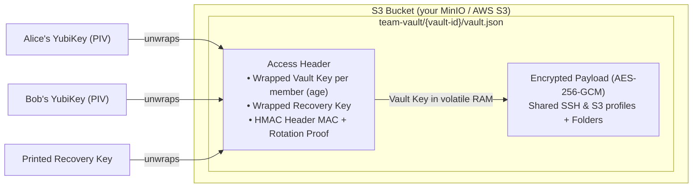
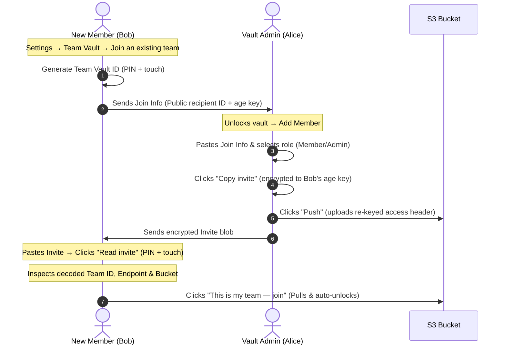

## Team Vault: Shared Connection Profiles

**Team Vault** lets a team securely share SSH and S3 connection profiles (including server hostnames, accounts, passwords, and secret access keys) through an S3 bucket you own. There is no shared master password, no centralized sshs3 cloud service, and no user account tracking: every member unlocks the vault with their own hardware **YubiKey**. Removing a team member is a single click that cryptographically revokes access through key rotation, and the S3 storage provider only ever sees authenticated ciphertext.

Team Vault is completely independent from [Remote Profile Synchronization](/docs/sync-environment/), which synchronizes *your personal* profiles between *your own* workstations. Personal profiles never enter any Team Vault, and shared profiles never land in your personal profile store. Furthermore, you can belong to **multiple Team Vaults** concurrently (e.g. *Infra Team*, *Database Ops*, *Customer Staging*), each with its own isolated vault file, membership list, and S3 backend.

<video autoplay loop muted playsinline width="100%" style="border-radius: 12px; border: 1px solid #334155; margin: 1.5rem 0;">
  <source src="/img/docs/team-vault-architecture.mp4" type="video/mp4" />
</video>

---

## 1. Before You Start

#### ✅ Requirements
- **YubiKey with PIV support** for every member (YubiKey 4 or 5 series). Other smartcards (Gemalto, Thales, SafeNet, SITHS, etc.) **cannot** be used: Team Vault relies on `age-plugin-yubikey`, which communicates directly with the YubiKey's hardware management protocol rather than a generic PKCS#11/PIV middleware.
- **Linux or Windows.** macOS is not yet supported. On Windows, YubiKey 5-series keys are verified working end-to-end; YubiKey 4-series keys do not currently work on Windows (the cause is still under investigation — they work fine on Linux).
- On Linux, `pcscd` installed and running on the host (the standard smartcard daemon already used for smartcard SSH authentication). Windows uses its built-in smartcard service instead — no extra install needed there.
- **An S3-compatible bucket** accessible by all team members (AWS S3, MinIO, Ceph, Wasabi, etc.). SFTP is not supported as a Team Vault storage target.

#### 🔑 Prepare your YubiKey (once)
A YubiKey PIV applet contains three distinct secrets: the **PIN**, the **PUK**, and the **Management Key**. Changing the PIN and PUK does *not* alter the Management Key.

| Card state | Action required |
|---|---|
| Factory-default PIN `123456` / PUK `12345678` | Change them first via `ykman piv access change-pin` and `ykman piv access change-puk`. sshs3 deliberately avoids running card credential wizards for you and will halt with an error if factory defaults are detected. |
| PIN/PUK changed, Management Key still factory default (common on YubiKey 4) | Nothing. The first **Generate my Team Vault ID** operation automatically migrates the default management key to a PIN-protected management key using the PIN you enter. |
| Custom Management Key, but not PIN-protected | Run `ykman piv access change-management-key --generate --protect` once in your terminal. sshs3 does not know your custom management key and will never prompt for or guess it. |

> [!NOTE]
> **Generate my Team Vault ID** generates a dedicated key in one of the YubiKey's 20 spare ("retired") PIV key management slots. Your existing SSH authentication key in slot `9a` is never modified or overwritten.

---

## 2. Create a Team Vault (First Admin)

1. Open **Settings → Team Vault** and click **Create a new team**.
2. Click **Generate my Team Vault ID**. Enter your YubiKey PIV PIN in the dialog and touch the gold sensor when the touch presence banner appears.
3. Fill in **Your recipient id**, which is the label other team members will see (e.g. `alice@corp.internal`). If a smartcard certificate with a UPN is configured in Remote Profile Sync, sshs3 automatically suggests your UPN.
4. Optionally enter a **Team name (optional)** (e.g. *Acme Infra Team*). The name is displayed in tab titles and team lists instead of the internal ID.
5. Click **Create team**. You become the vault's founding **Admin**.
6. **Save your emergency recovery key.** The recovery key (`AGE-SECRET-KEY-1...`) is displayed exactly once. Click **Copy recovery key** or print it out, store it securely (e.g., in a physical safe), tick **I have printed/saved this recovery key**, and click **Done**. See [Recovery](#7-recovery-when-a-card-is-lost).

#### ☁️ Configure Remote S3 Synchronization
1. On the team's detail page, under **Remote sync (S3)**, click **Configure target**.
2. Enter the S3 endpoint, credentials (Access Key ID and Secret Access Key), and the target bucket (optionally with a prefix, e.g. `company-vaults/production`). The vault file is stored at `team-vault/<vault-id>/vault.json` under that path. All credentials are encrypted with your OS keychain (`safeStorage`).
3. Click **Push** to upload the initial vault payload to S3.

When editing an existing target later via **Edit target**, non-secret fields (endpoint, region, access key ID, bucket) are pre-filled automatically. The **Secret Access Key** field is left blank to retain your existing saved key, or you can type a new one to replace it. A **Test Connection** button is available to verify S3 connectivity before saving.

Admins can update the team name or provide a multiline **Description** at any time.

---

## 3. Adding Members & Joining Teams

Team Vault uses an asymmetric invite workflow designed to eliminate manual S3 configuration while preventing unauthorized server connections.

### Step 1: The New Member Requests Access
1. Open **Settings → Team Vault** and click **Join an existing team**.
2. Under **Step 1**, click **Generate my Team Vault ID** (enter PIV PIN and touch the YubiKey).
3. Type **Your recipient id** (e.g. `bob@corp.internal`).
4. Click **Copy join info** and send the resulting text block to a vault Admin via chat, ticket, or email. Because this block contains only public identifiers, transmitting it over standard communication channels is completely safe.

### Step 2: The Admin Enrolls the Member & Generates an Invite
1. Open **Settings → Team Vault**, select the team, and **Unlock** it.
2. In the **Add a member** section, paste the member's join info block. sshs3 automatically parses and validates the recipient ID and public `age1yubikey1...` string.
3. Select their initial role (**Member** or **Admin**) and click **Add member**.
4. In the members table, click **Copy invite** next to the new member's name. This packages the vault ID, S3 endpoint, region, credentials, and bucket path into a ciphertext payload encrypted specifically to that member's public hardware key.
5. Click **Push** to upload the updated access header to S3.
6. Send the copied invite block to the new member.

### Step 3: The New Member Verifies & Joins
1. Back in **Settings → Team Vault → Join an existing team**, navigate to **Step 2**.
2. Paste the invite block into **Paste invite from your admin** and click **Read invite**. Enter your PIV PIN and touch the key.
3. **Verify the decoded team details:** sshs3 decrypts the invite and presents the Team ID, S3 Endpoint, Region, and Path for human verification.
   > [!IMPORTANT]
   > While `age` encryption proves the invite was addressed to your YubiKey, it does not authenticate the sender. Reviewing the decoded target before connecting prevents malicious endpoints from being accepted blindly.
4. Click **This is my team — join**. sshs3 configures the S3 target, downloads the vault file from S3, and unlocks it immediately.

*(If preferred, teams can bypass invite blobs and configure S3 targets manually via the collapsed **...or configure manually** fallback).*

---

## 4. Roles & Secret Protection

Team Vault enforces strict role separation directly within the main process:

| Capability | Admin | Member |
|---|:---:|:---:|
| Connect to shared SSH and S3 targets | ✅ | ✅ |
| Add, edit, and organize shared profiles & folders | ✅ | ✅ |
| **View plaintext passwords, passphrases & secret keys** | ✅ | ❌ *(redacted)* |
| **Modify or overwrite stored credentials** | ✅ | ❌ *(preserved)* |
| Copy member invites (`team-vault:build-invite`) | ✅ | ❌ |
| Add / remove members, promote / demote roles | ✅ | ❌ |
| Rename vault & edit team description | ✅ | ❌ |
| Delete or remove vault from this device | ✅ | ❌ |

### How Credential Protection Works for Members
Non-admin members can connect to shared servers and S3 endpoints transparently, but they cannot read or exfiltrate passwords or secret access keys:
- When a non-admin reads the vault payload (`getPayloadForRenderer`), the main process strips all plaintext secrets (`password`, `passphrase`, `proxy.password`, `secretAccessKey`, `sessionToken`) and replaces them with boolean flags (`hasPassword: true`, `hasSecretAccessKey: true`).
- When a non-admin initiates an SSH or SFTP connection, the main process looks up the full profile internally in memory (`resolveProfileForConnect`), authenticating the connection without exposing the raw secret to the renderer process.
- If a non-admin saves changes to a shared profile, any existing secrets are preserved intact; members cannot overwrite secrets with blank values or new values.

### Offboarding a Member
When an Admin removes a member (**Remove member**):
1. sshs3 generates a brand-new 32-byte AES-256-GCM **Vault Key**.
2. The entire payload (profiles, folders, credentials) is re-encrypted with the new key.
3. The new Vault Key is wrapped individually for each remaining member and for the recovery key.
4. The file's cryptographic rotation proof (`prevKeyProof`) is signed with the old Vault Key.
5. The removed member retains only whatever local snapshot they had previously downloaded; they are permanently locked out of all subsequent pulls, profile updates, and key rotations.

Keep **at least two admins** in every vault. The settings view warns whenever a vault has only one admin, as losing that single card leaves the emergency recovery key as the only administrative path. When another member is present, the warning provides a direct **"Promote <member>"** action to elevate them to co-admin with one click.

---

## 5. Unlocking & Session Management

Shared profiles and credentials remain accessible in memory only while the vault is unlocked. You can unlock from:
- **Connection Manager** → click the team's tab → click **Unlock as *your-id*** (or use the **Unlock all** button in the top bar to unlock multiple teams sequentially), or
- **Settings → Team Vault** → select the team → click **Unlock** (the team list overview also provides a quick unlock/lock button and sync status indicator for each team).

Enter your PIV PIN and touch the YubiKey when prompted. sshs3 remembers which identity file and recipient ID you used for each team (never your PIN), allowing one-click unlocking on subsequent launches.

- **Lock Now:** An unlocked vault can be locked at any time by clicking **Lock now** in the team's detail panel or in the team list.
- **Use a different identity...**: Expands manual inputs to supply a custom recipient ID or identity file path (useful on fresh installations).
- **Session Security**: The decrypted Vault Key is held exclusively in volatile RAM and is scrubbed immediately when you click **Lock** or quit sshs3. It is never cached to disk, swap, or the operating system keychain.

---

## 6. Using Shared Profiles in the Connection Manager

When Team Vaults are configured, the **Connection Manager** (<kbd>Ctrl+Shift+O</kbd>) displays dedicated tabs across the top: **Personal** followed by a tab for each configured team (e.g. `[Acme Infra]`, `[Security Ops]`).

- **Team Tabs & Visibility:** You can toggle whether each team appears as a tab in Connection Manager via the checkbox **Show this team as a tab in the Connection Manager** (Settings → Team Vault).
- **Team Description:** Admins can provide a multiline description explaining what the team vault is for. Members can read the description directly on the team's tab, and admins can edit it inline with the pencil icon.
- **Profile Operations:** Creating, editing, duplicating, and connecting to SSH and S3 profiles works identically to personal profiles.
- **PKCS#11 / Smartcard Profiles:** Leave the PKCS#11 library path blank on shared profiles. Each member's local default from **Settings → Security & Smartcard** is applied automatically, accommodating differing Linux distributions without per-profile configuration.
- **Private Key Paths:** File paths to private keys are shared verbatim. If team members use SSH private keys, ensure the key files are stored at consistent filesystem paths across workstations.

#### 📁 Hierarchical Folders & Custom Icons
Shared profiles can be organized into arbitrary directory trees synchronized across all team members:
- Folders are rendered as interactive **cards**. Press <kbd>Enter</kbd> or click a card to navigate inside. Breadcrumb navigation at the top provides quick traversal back up the hierarchy.
- **New top-level folder** and **New subfolder** create empty directories that persist across team syncs.
- Organize profiles by **dragging and dropping** cards onto folder cards or breadcrumb segments, or by setting the profile's **Group / Folder** property (e.g. `Databases/Postgres/Replica`).
- Click the icon on any folder card to choose from 12 distinct icons (**server**, **database**, **cloud**, **shield**, **globe**, **box**, **hard-drive**, **network**, **git-branch**, **cpu**, **layers**, or default **folder**).
- Deleting a folder moves its profiles to **Ungrouped** rather than deleting them.

#### 🔍 Global Search
Typing into the search bar instantly searches across **all** profiles in the active team vault regardless of current folder depth. Results display their full folder path hierarchy. Clearing search restores the folder view.

#### 🔄 Automatic Synchronization & Conflict Handling
- **Local Changes:** Edits to profiles, folders, or team metadata are automatically pushed to S3 approximately two seconds after saving.
- **Background Polling:** While unlocked, sshs3 checks S3 every 3 minutes for remote revisions. New changes are pulled automatically, updating the interface with *"Updated from another member"*.
- **Sync Status Preview:** In Settings, the **Push** and **Pull** buttons display a live status preview (indicating whether there are unpushed local changes or remote updates waiting to be pulled) before initiating a sync.
- **Conflict Resolution:** If remote changes occur while you have unpushed local modifications, sshs3 halts automatic overwrites and displays a **"Get latest"** conflict action. You can inspect the divergence and choose whether to push your version or discard local changes to pull the remote state.

---

## 7. Recovery When a Card Is Lost

The **Recovery Key** (`AGE-SECRET-KEY-1...`) acts as an emergency software administrative credential. It is completely independent of hardware smartcards.

1. On any machine with sshs3, navigate to **Settings → Team Vault**. (If setting up on a new device, click **Join an existing team** or configure the S3 target under the manual fallback to pull the vault).
2. Open the team and click **Lost your card? Recover using your saved recovery key...**.
3. Paste the recovery key block into the text box and click **Recover vault access**.
4. The vault unlocks with full Admin rights. You can now enroll a replacement YubiKey, add it via **Add a member**, click **Push**, and remove the lost YubiKey's entry.

sshs3 never stores the recovery key on disk; the pasted text is piped to `age` over stdin and discarded, never written to a file at any point.

#### 🧹 Removing a Team From One Machine
- **Remove team from this device** (available for locked vaults in the team list): Clears the local vault file, identity path, and configuration from this workstation only. Remote S3 data and other members are completely unaffected.
- **Remove vault from this machine** (Admin danger zone on the detail panel): Erases the local vault instance. You can re-join the team at any time via invite or manual S3 pull.

---

## 8. Security Architecture & Limitations

### 🛡️ Threat Model & Cryptographic Guarantees

| Attack Vector | Defense Mechanism |
|---|---|
| **Eavesdropping on S3 bucket** | **Zero-Knowledge Ciphertext.** All profile data, folder metadata, passwords, and keys are encrypted with AES-256-GCM. The S3 provider sees only random ciphertext. |
| **S3 Bucket Write Tampering** | **HMAC-SHA256 Access Header MAC.** The access header (member list, public keys, roles, vault name, description, revision) is authenticated by a subkey derived from the Vault Key. An attacker with S3 write access cannot modify roles, insert new members, or tamper with keys without invalidating the MAC. |
| **Replay & Rollback Attacks** | **Monotonic Revisions.** Every mutating write increments `revision`. `pullFromRemote` strictly rejects incoming files with older revision counters. |
| **Unauthorized Member Removal** | **Rotation Proof (`prevKeyProof`).** Rotating the Vault Key requires computing an HMAC proof keyed by the *previous* Vault Key, proving the rotation was executed by an active member holding valid credentials. |
| **Delimiter Collision Injection** | **Canonical Input Validation.** All metadata fields (vault ID, name, description, recipient IDs) are validated to ensure they cannot contain canonicalization delimiter bytes (`\u0001`, `\u0002`, `\u0003`), eliminating field-boundary manipulation. |
| **Untrusted S3 Redirection** | **Two-Stage Invite Verification.** Decrypting an invite does not connect automatically; users must visually confirm the target endpoint and bucket before joining. |
| **Memory & Process Safety** | **In-memory channels & node-pty.** Decrypted Vault Keys are piped directly from `age` through a RAM-backed channel — a FIFO on Linux, a named pipe on Windows — and never touch disk. PIN prompts are relayed via pseudo-terminal to prevent console scraping. |

### ⚠️ Known Limitations
- **YubiKey Only:** Only YubiKey 4 and 5 series hardware keys are supported. Generic smartcards (PKCS#11/PIV) do not implement the necessary management protocols required by `age-plugin-yubikey`.
- **macOS Not Yet Supported:** Team Vault currently runs on Linux and Windows only.
- **YubiKey 4 on Windows:** Does not currently work on Windows (works fine on Linux); the cause hasn't been root-caused yet.
- **S3 Storage Only:** Only S3-compatible object storage is supported. SFTP and Git are not supported storage backends for Team Vault.
- **Offline Removal Threshold:** A workstation that misses more than one consecutive member removal / key rotation cycle while offline cannot verify intermediate rotation proofs. In that event, pull is halted, and the member should forget the local vault and re-pull fresh after verifying the member list with an admin.
- **No Per-Folder Access Control:** All members of a given Team Vault can access all connection profiles within that vault. For segregated permissions (e.g. Production vs. Staging), create separate Team Vaults.

#### ⚙️ Technical Internals
- `TeamVaultService` (`src/main/services/TeamVaultService.ts`): Orchestrates local vault files (`~/.config/sshs3/team-vaults/<vault-id>.json`), mutation queues, and memory Vault Key caching.
- `TeamVaultCryptoService` (`src/main/services/TeamVaultCryptoService.ts`): Manages AES-256-GCM payload encryption, HMAC access-header MAC calculation, rotation proofs, and age envelope wrapping.
- `AgePtyPinRelay` (`src/main/services/AgePtyPinRelay.ts`): Spawns bundled `age` and `age-plugin-yubikey` processes in an isolated pseudo-terminal, relaying PIN and touch events directly to Electron modals.
- `TeamVaultConfigStore` (`src/main/services/TeamVaultConfigStore.ts`): Stores per-vault S3 connection parameters and remembered local identity mappings.
